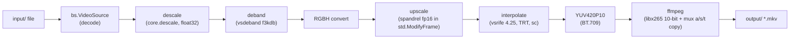

<div align="center">

# 🎬 anime-upscale

**Anime video pipeline: descale → deband → AI-upscale → RIFE interpolation → x265 encode — every stage optional, one TOML config, zero env vars.**


[Architecture plan](docs/architecture-plan.md) · [Benchmarks](benchmarks/) · [Research](research/)

</div>

## 📑 Table of Contents

- [✨ Features](#-features)
- [🔀 Pipeline](#-pipeline)
- [🚀 Quick Start](#-quick-start)
- [🎮 Usage](#-usage)
- [⚙️ Configuration](#️-configuration)
- [📦 Batch & remote input](#-batch--remote-input)
- [🖥️ Hardware](#️-hardware)
- [📊 Benchmarks](#-benchmarks)
- [🗂️ Project structure](#️-project-structure)
- [🪟 Windows notes](#-windows-notes)
- [🧪 Development](#-development)

## ✨ Features

- **Fixed, research-backed stack** — vsrife 5.7.0 (RIFE 4.25, TensorRT), 2x_AnimeJaNai HD V3 Compact (sha256-pinned) via spandrel, vsdeband f3kdb, descale, CPU-only libx265 10-bit (CRF 16 slow, VCB anime flag sheet, BT.709 tags).
- **Arbitrary stage subsets** — `--profile full | upscale-only | interp-only` or any `--stages` list; canonical order is fixed, order decisions live in one registry.
- **One graph, one process** — the VapourSynth graph is assembled in Python (no `.vpy`/`vspipe`); frames flow y4m straight into the ffmpeg encode/mux subprocess.
- **Exact rational fps** — `--target-fps 60000/1001` (or `23.976` → `24000/1001`); scene changes pass through untouched.
- **Sequential batch** — repeatable `-i`, per-file banners (`◈ Файл 2/5`), continue-and-summarize with a Russian end summary and honest exit codes.
- **Remote ingestion** — direct URLs and gofile links (folders expand in place, video whitelist) download into `input/` via strict Google-DoH-pinned connections (no system-resolver fallback, ever).
- **gofile upload post-step** — `--upload` publishes the finished output and prints the link; token optional, failure never touches the file.
- **Self-configuring hardware** — torch probes the GPU, a VRAM budget formula derives inference streams, `nvidia-smi` is diagnostics only; zero-GPU + NN-stage is a loud error.

## 🔀 Pipeline



| Stage | Engine | Key knobs |
| :-- | :-- | :-- |
| descale | `core.descale` (v12 float32 dekernels) | kernel, src_left/top, per-run height |
| deband | vsdeband `f3k_deband` (vszip plugin) | radius, threshold[3], grain[2] |
| upscale | spandrel `2x_AnimeJaNai_HD_V3_Compact` (sha256-pinned) | fp16, model name via manifest |
| interpolate | vsrife 5.7.0, model `4.25`, Torch-TensorRT | `fps_num/fps_den`, `sc`, `trt_cache_dir` |
| encode | libx265 10-bit (CPU, `slow`, CRF 16) | keyint = 10 s rule from output fps, VCB sheet |

**Numbered flow — a single file run:**

1. CLI parses flags; config.toml is loaded and validated (unknown keys = hard error).
2. Pre-flight: stage subset resolved (CLI > profile > `[stages.*]` > defaults), hardware probed, models sha256-verified, gofile/URL entries expanded into the batch queue (metadata only).
3. For each entry: download if remote (`.part` → atomic rename), assemble the VS graph, feed y4m into ffmpeg, mux audio/subs/attachments/chapters from the source.
4. Optional `--upload` per entry; end-of-batch summary («Итог: N/M успешно») and exit code (0 ok / 1 pipeline / 3 upload-only failures).

**Numbered flow — gofile folder entry:**

1. `gofile.io/d/<id>` is classified as a gofile entry; the DoH-pinned client fetches `/contents/{id}` with the wt (X-Website-Token) scheme ported from the owner's gofile-dl tool.
2. Children are walked recursively (dict-or-list payloads normalized), folders first then files, each alphabetically.
3. Non-video extensions are skipped with a printed note; an empty-after-filter folder is a loud error.
4. Every video child joins the batch queue at the entry's position; downloads happen at that file's turn under the batch failure policy.

## 🚀 Quick Start

1. **Install uv** (the only prerequisite besides an NVIDIA driver + ffmpeg in PATH):

   ```bash
   curl -LsSf https://astral.sh/uv/install.sh | sh
   ```

2. **Create the environment** (resolves torch from the cu130 index into `.venv`):

   ```bash
   uv sync --all-groups
   ```

3. **Build the misc plugin** (SCDetect; ships with VS installers but not the PyPI wheel):

   ```bash
   bash scripts/build_misc_plugin.sh
   ```

4. **Fetch + verify the upscale model** (sha256-pinned in `models/manifest.toml`):

   ```bash
   uv run anime-pipeline models fetch
   uv run anime-pipeline models verify
   ```

5. **Run a chain** — put a file into `input/`, then:

   ```bash
   uv run anime-pipeline --profile interp-only -i "episode_01.mkv"
   ```

## 🎮 Usage

```text
anime-pipeline (--profile NAME | --stages LIST) [-i ENTRY ...] [-o NAME]
               [--config PATH] [--target-fps NUM|NUM/DEN] [--descale-height N]
               [--upload] [--no-color] [--no-tty]
anime-pipeline models fetch|verify
```

| Flag | Meaning |
| :-- | :-- |
| `-i` (repeatable) | bare name in `input/` · `https://` direct URL · `gofile.io/d/<id>` link |
| `-o` | output name in `output/` (`.mkv` forced; default = input stem) |
| `--target-fps` | exact rational (`60000/1001`) or decimal (`23.976` → `24000/1001`) |
| `--descale-height` | required whenever the descale stage is selected |
| `--upload` | gofile upload post-step after a completed run |
| `--no-color` / `--no-tty` | strip ANSI / force plain non-interactive output |

```bash
# interpolation only (exact 59.94 from 23.976)
uv run anime-pipeline --profile interp-only -i "episode_01.mkv" --target-fps 60000/1001

# full chain with an explicit descale target and gofile upload
uv run anime-pipeline --profile full -i "episode_01.mkv" --descale-height 1080 --upload

# arbitrary subset + batch (sequential, summarized)
uv run anime-pipeline --stages descale,deband,encode -i "a.mkv" -i "https://host/b.mkv"
```

## ⚙️ Configuration

One file: `config.toml`. No environment variables at any layer. Unknown keys are hard errors. Merge precedence: **CLI > profile > `[stages.*]` > built-in defaults**.

| Section | Purpose |
| :-- | :-- |
| `[pipeline]` | canonical stage order (fixed in v1) |
| `[hardware]` | optional overrides: `num_streams`, `gpus`, `encode_threads` |
| `[stages.descale/deband/upscale/interpolate/encode]` | all stage parameters (see the file for per-flag rationale) |
| `[stages.encode.x265_params]` | pass-through x265 sheet; `keyint/min-keyint` computed unless overridden |
| `[models]` | models dir + manifest path |
| `[upload.gofile]` | optional premium token (also used for downloads) |
| `[fetch.gofile]` | wt-scheme overrides (`wt_salt`, `user_agent`, `language`) |
| `[tools]` | explicit ffmpeg/ffprobe paths (empty = PATH lookup) |
| `[profiles.*]` | named subsets + per-stage deep overrides (`[profiles.X.overrides.Y]`) |

The gofile guest token is runtime state, not configuration: it lives in `$XDG_STATE_HOME/anime_upscale/gofile_guest.toml` (Windows: `%LOCALAPPDATA%\anime_upscale\state\…`) and is created once, then reused.

## 📦 Batch & remote input

- Entries run strictly sequentially in CLI order; per-file banners carry the real expanded queue (`M` includes gofile folder expansion).
- Failure policy: continue-and-summarize — every entry is attempted, failures are named in the summary, exit is non-zero unless every entry succeeded.
- Downloads are idempotent: an existing `input/<name>` is skipped with a printed note.
- Within one invocation, download name collisions disambiguate as `<stem>-2<ext>` with a loud warning; bare names are never renamed.
- Pre-flight failures (config, hardware, models, collisions) abort before the first entry.

## 🖥️ Hardware

Detection is a capability probe, never a config source: torch reports GPUs/VRAM, `nvidia-smi` cross-checks (diagnostics only). The frozen `HardwareProfile` derives `num_streams` from the VRAM budget formula (16 GB → 2/GPU, 24 GB → 3/GPU) and `encode_threads` from logical cores. Selecting `upscale`/`interpolate` on a zero-GPU machine fails loudly with an actionable message.

## 📊 Benchmarks

First entry: [`benchmarks/2026-10-27-GeForceGTX1650.md`](benchmarks/2026-10-27-GeForceGTX1650.md) — 640×360×12 s synthetic sample, single GPU:

| chain | wall | fps |
| :-- | --: | --: |
| encode-only | 35.2 s | 8.18 |
| interp-only (720 out frames) | 88.1 s | 8.17 |
| upscale-only (288 out frames) | 154.7 s | 1.86 |
| full-chain | 196.7 s | 3.66 |

Regenerate with `uv run python scripts/benchmark.py -i sample.mkv`.

## 🗂️ Project structure

```
anime_upscale/
├── pyproject.toml            # PEP 621 + [tool.uv] cu130 index + ruff/ty/pytest config
├── uv.lock                   # committed lockfile (no version pins in the manifest)
├── config.toml               # SINGLE source of truth (no env vars anywhere)
├── input/  output/           # the ONLY I/O dirs; contents gitignored
├── docs/
│   ├── architecture-plan.md  # binding spec (v1.3)
│   └── vs-mlrt-trt-notes.md  # TRT escape-hatch notes for the upscale stage
├── src/anime_upscale/
│   ├── cli.py                # root command + models subcommand + batch driver
│   ├── config.py             # TOML → one frozen Config; merge precedence; hard errors
│   ├── pipeline.py           # graph assembly + y4m → ffmpeg wiring
│   ├── ffmpeg.py             # mux argv builder + stderr-drained encoder handle
│   ├── hardware.py           # frozen HardwareProfile + VRAM budget + banner
│   ├── reporting.py          # Russian colored TTY, --no-color/--no-tty, VT enable
│   ├── tools.py              # PATH-first [tools] overrides (ffmpeg/ffprobe)
│   ├── fetch_input.py        # entry grammar, filename precedence, collisions
│   ├── gofile.py             # DoH pinning, wt scheme, guest-token lifecycle
│   ├── upload.py             # gofile upload post-step
│   ├── models/               # manifest parse + sha256 fetch/verify
│   └── stages/               # registry: descale, deband, upscale, interpolate, encode
├── tests/                    # 138 tests; GPU/VS-marked tests skip gracefully
├── scripts/                  # benchmark.py + build_misc_plugin.sh
├── benchmarks/               # dated per-GPU results
└── research/                 # verified canon the stack decisions came from
```

## 🪟 Windows notes

The pipeline targets both Linux and Windows: pathlib everywhere, spawn-safe process model (no fork), platform-aware state paths, `[tools]` overrides for ffmpeg/ffprobe, VT-enabled colored console, identical `--no-color`/`--no-tty`. Wheels verified for the current stack (see the architecture plan §12). The `misc` plugin step differs: on Windows take `misc.dll` from the official VapourSynth installer and drop it into `.venv\Lib\site-packages\vapoursynth\plugins\misc\` instead of running the g++ script.

## 🧪 Development

```bash
uv sync --all-groups              # environment (torch via cu130 index)
uv run ruff format .              # formatting
uv run ruff check .               # lint gate (select ALL, 0 warnings)
uv run ty check src/              # type gate
uv run pytest                     # test gate (GPU-marked tests need CUDA)
```

Commits follow Conventional Commits; every behavior change lands with tests first (TDD). The binding spec is [`docs/architecture-plan.md`](docs/architecture-plan.md) — read it before proposing structural changes.
