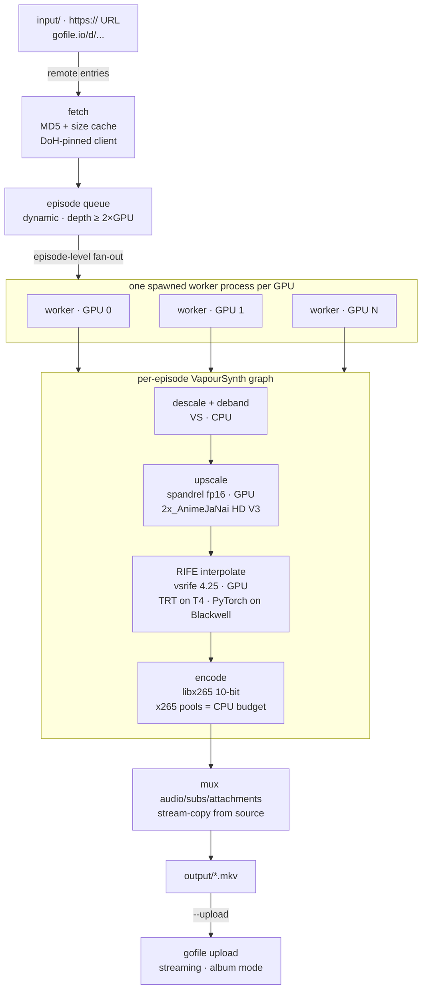

# 🎬 anime-upscale

<div align="center">

**Anime video pipeline: descale → deband → AI-upscale → RIFE interpolation → x265 encode — every stage optional, one TOML config, zero env vars.**

A research-backed VapourSynth pipeline assembled as one in-process graph: spandrel AI upscaling with sha256-pinned weights, vsrife RIFE 4.25 interpolation to any rational fps, and a CPU-only libx265 10-bit encode with a VCB anime flag sheet. Batches run sequentially or fan out episode-per-GPU, ingest from URLs and gofile folders through a DoH-pinned client, publish back to gofile, and run equally on a local NVIDIA box, Docker, Kaggle, or Colab.

[](https://www.python.org/)
[](https://www.vapoursynth.com/)
[](https://download.pytorch.org/whl/cu130)
[](https://docs.astral.sh/uv/)
[](https://docs.astral.sh/ruff/)
[](https://docs.astral.sh/ty/)
[](https://docs.docker.com/compose/)

[](https://ffmpeg.org/)
[](https://docs.nvidia.com/deeplearning/tensorrt/)
[](https://www.kaggle.com/docs/notebooks)
[](https://colab.research.google.com/)
[](https://github.com/4q4r/anime_upscale/commits)
[](https://github.com/4q4r/anime_upscale)

[Architecture](#-system-architecture) · [Notebooks](#-notebooks) · [Docker](#-docker) · [Multi-GPU](#-multi-gpu-load-distribution) · [Performance](docs/performance.md) · [Benchmarks](#-benchmarks) · [Testing](#-testing)

</div>

---

## 📑 Table of Contents

- [System Architecture](#-system-architecture)
- [Features](#-features)
- [Multi-GPU Load Distribution](#-multi-gpu-load-distribution)
- [Project Structure](#-project-structure)
- [Configuration](#-configuration)
- [Docker](#-docker)
- [Notebooks](#-notebooks)
- [Performance Guide](docs/performance.md)
- [Benchmarks](#-benchmarks)
- [Quick Start](#-quick-start)
- [Testing](#-testing)
- [Limitations](#-limitations)
- [Security](#-security)

---

## 🗺️ System Architecture



A run, end to end:

1. **Pre-flight** — `config.toml` is loaded and validated (unknown key = hard error), hardware is probed, models are sha256-verified, and every `-i` entry (bare names, direct URLs, gofile links) is expanded into the batch queue; gofile folders expand recursively with a video-extension whitelist.
2. **Remote entries download at their turn** — `.part` → atomic rename, idempotent skip for existing files, MD5 + size cache, all through the strictly DoH-pinned client (the system resolver is never consulted).
3. **Distribution** — two or more GPUs run episode-level fan-out: one spawned worker process per GPU pulls episodes from a shared dynamic queue, so a faster card takes more entries. A single GPU keeps the exact sequential driver.
4. **Per episode** — the embedded VapourSynth graph (decode → descale → deband → RGBH → upscale → interpolate → YUV420P10 BT.709) feeds y4m frames straight into the ffmpeg subprocess; audio, subtitles, attachments, and chapters are stream-copied from the source into the final `.mkv`.
5. **Post-step** — `--upload` publishes the finished file to gofile (streaming, one album per batch by default); an upload failure never touches the output file.
6. **Summary** — per-entry `✗`/`✓` reporting at the point of death, a Russian end summary, and honest exit codes (0 all good / 1 pipeline failure / 3 upload-only failures).

---

## ✨ Features

- **Fixed, research-backed stack** — vsrife 5.7.0 (RIFE 4.25, TensorRT on Turing), 2x_AnimeJaNai HD V3 Compact (sha256-pinned) via spandrel, vsdeband f3kdb, descale, CPU-only libx265 10-bit (CRF 16, VCB anime flag sheet, BT.709 tags).
- **Arbitrary stage subsets** — `--profile full | upscale-only | interp-only` or any `--stages` list; the canonical order is fixed, subset decisions live in one registry.
- **One graph, one process** — the VapourSynth graph is assembled in Python (no `.vpy`/`vspipe`); frames flow y4m straight into the ffmpeg encode/mux subprocess.
- **Exact rational fps** — `--target-fps 60000/1001` (or `23.976` → `24000/1001`); scene changes pass through untouched.
- **Sequential batch with honest reporting** — repeatable `-i`, per-file banners, loud `✗` at the point of any failure, continue-and-summarize policy, non-zero exit unless every entry succeeded.
- **Remote ingestion + publication** — direct URLs and gofile links (folders expand in place) download into `input/`; `--upload` publishes finished `.mkv` files back to gofile.
- **Self-configuring hardware** — torch probes the GPU, VRAM and CPU budgets derive stream/encoder counts (measured anchors override the formulas), `nvidia-smi` is diagnostics only; zero-GPU + NN-stage is a loud error.
- **Four runtimes, one repo** — Linux and Windows native, a GPU Docker image, and Kaggle/Colab notebooks with a fail-fast bootstrap.

---

## 🎛️ Multi-GPU Load Distribution

Work is distributed **per episode, never per clip**: an anime episode is never split across GPUs because RIFE interpolation is temporally consistent across the whole clip (the vs-mlrt position on segment seams).

- **Fan-out** — with two or more GPUs (auto-detected or `[hardware] gpus`), the driver spawns one worker process per GPU with an explicit `spawn` context and a `CUDA_VISIBLE_DEVICES` pin at child start. Workers pull episodes from a shared dynamic queue (pre-loaded to depth ≥ 2×GPU), so per-card speed differences translate into more entries per fast card. The parent collects results and prints a summary byte-identical to the sequential driver's; album upload chaining is preserved via a head-entry hold-back.
- **Single GPU / zero GPU** — the sequential v1 driver runs unchanged (pinned by tests); a single episode never crosses GPUs.
- **Measured anchors** — `scripts/benchmark.py --sweep streams --sweep pools` writes `benchmarks/<gpu-slug>/anchor.json` (schema-invalidated by `gpu_name`/driver/`run_config` changes). Resolution priority: **CLI flag > `[hardware]` config > measured anchor > formula** — and the run banner names which source produced the numbers («замер / формула / конфиг»).
- **Formula fallback** — without an anchor, VS prefetch depth comes from a VRAM budget formula (16 GB → 2 streams, 24 GB → 3, T4 15 GB → 1); the encoder CPU budget comes from `usable_cpu_count()` (affinity- and cgroup v2-aware) divided among active encoders, landing in `x265 pools=N` — never `ffmpeg -threads`.

---

## 📂 Project Structure

```text
anime_upscale/
├── pyproject.toml              PEP 621 manifest · cu130 torch index · ruff ALL / ty / pytest config
├── uv.lock                     committed lockfile (no version pins in the manifest)
├── config.toml                 SINGLE source of truth (no env vars anywhere)
├── Dockerfile                  multi-stage: venv + misc plugin + verified weights baked in
├── compose.yaml                run-once GPU container: gpus: all + bind mounts
├── input/  output/             the ONLY I/O dirs (contents gitignored)
├── docs/
│   ├── architecture-plan.md    binding spec (v1.3 as-implemented amendments)
│   ├── docker.md               image contract · host setup · doctor checklist
│   ├── notebooks.md            Kaggle/Colab compatibility matrix (dated facts)
│   └── vs-mlrt-trt-notes.md    TRT escape-hatch notes for the upscale stage
├── notebooks/
│   ├── kaggle_run.ipynb        Kaggle T4 x2 runner (fail-fast RU bootstrap)
│   ├── colab_run.ipynb         Colab T4 runner (cu126 swap + TRT ladder + Drive)
│   └── README.md               step-by-step usage + honest session-budget math
├── src/anime_upscale/
│   ├── cli.py                  root command · models subcommand · batch driver · fan-out
│   ├── config.py               TOML → one frozen Config; unknown key = hard error
│   ├── pipeline.py             VS graph assembly · y4m → ffmpeg wiring · prefetch budget
│   ├── hardware.py             HardwareProfile · stream/encoder budgets · measured anchors
│   ├── runtime_env.py          local/kaggle/colab detection (read-only, stdlib only)
│   ├── fetch_input.py          entry grammar: names · URLs · gofile folders · collisions
│   ├── gofile.py               DoH pinning · wt scheme · guest-token lifecycle
│   ├── upload.py               gofile upload post-step (streaming, album/separate)
│   ├── ffmpeg.py               mux argv builder · stderr-drained encoder handle
│   ├── ffmpeg_repair.py        zero-touch winget ffmpeg repair (Windows)
│   ├── reporting.py            Russian colored TTY · --no-color/--no-tty
│   ├── tools.py                PATH-first [tools] overrides (ffmpeg/ffprobe)
│   ├── models/                 manifest parse · sha256 fetch/verify
│   └── stages/                 registry: descale, deband, upscale, interpolate, encode
├── tests/                      550+ tests; GPU/VS-marked tests skip gracefully
├── scripts/                    benchmark.py · build_misc_plugin.{sh,bat} · docker-smoke.sh
├── benchmarks/                 dated per-GPU results · <gpu-slug>/anchor.json
└── research/                   verified canon the stack decisions came from
```

---

## ⚙️ Configuration

One file: `config.toml`. No environment variables at any layer; unknown keys are hard errors. Merge precedence: **CLI > profile > `[stages.*]` > built-in defaults**. A trimmed excerpt (the committed file carries per-flag rationale comments):

```toml
[pipeline]
order = ["descale", "deband", "upscale", "interpolate", "encode"]  # canonical; profiles pick subsets

[hardware]                        # optional overrides — priority: CLI > [hardware] > measured anchor > detect
# num_streams = 3                 # VS prefetch depth (NOT GPU inference parallelism)
# gpus = [0]                      # 2+ GPUs = episode-level fan-out, one worker per GPU
# encode_threads = 12             # x265 pools budget (otherwise affinity/cgroup-aware)

[stages.interpolate]
model = "4.25"
target_fps = "60000/1001"
scene_detection = true
trt = true                        # auto-degrades to PyTorch CUDA FP16 on Blackwell

[stages.encode]
crf = 16                          # 14 = collection / 16 = VCB workhorse / 18 = community floor
preset = "medium"
pix_fmt = "yuv420p10le"

[stages.encode.x265_params]       # pass-through sheet (no-sao, psy-rd 2.0, aq-mode 3, ...)
no-sao = 1
psy-rd = 2.0
aq-mode = 3

[upload.gofile]
token = ""                        # OPTIONAL premium token; empty = anonymous upload
mode = "album"                    # one album per batch (or "separate" per-file links)

[profiles.full]
stages = ["descale", "deband", "upscale", "interpolate", "encode"]
upload = true
descale_height = 1080

[profiles.interp-only]
stages = ["interpolate", "encode"]

[profiles.interp-only.overrides.interpolate]
target_fps = "60/1"
```

Other sections: `[stages.descale]`, `[stages.deband]`, `[stages.upscale]` (model from `models/manifest.toml`, `fp16`), `[models]` (dir + manifest path), `[network]` (`strict_tls`), `[fetch.gofile]` (wt-scheme overrides), `[tools]` (explicit ffmpeg/ffprobe paths, empty = PATH). The gofile guest token is **runtime state, not configuration**: it lives in `$XDG_STATE_HOME/anime_upscale/gofile_guest.toml` (Windows: `%LOCALAPPDATA%\anime_upscale\state\…`), is created once with `0600` permissions, then reused.

---

## 🐳 Docker

One image carries everything version-specific: the `.venv` synced from the committed `uv.lock`, the compiled `misc.SCDetect` plugin, sha256-verified model weights (including the RIFE pre-seed), and apt ffmpeg with libx265 10-bit — the runtime never downloads model binaries on first use. The host needs only the NVIDIA driver (+ NVIDIA Container Toolkit; on Windows Server via WSL2 — the full walk-through lives in [`docs/docker.md`](docs/docker.md)).

| Host path | Container path | Purpose |
| :-- | :-- | :-- |
| `./input` | `/app/input` | source video |
| `./output` | `/app/output` | finished `.mkv` files |
| `./config.toml` | `/app/config.toml` | the one configuration file |
| `./cache/trt` *(optional)* | `/home/app/.cache/vsrife` | persistent TensorRT engine cache (pre-create on the host) |

```bash
mkdir -p cache/trt                  # your user, not root (container runs as uid 1000)
docker compose build
docker compose run --rm anime-pipeline --profile interp-only --upload
```

`compose.yaml` sets `gpus: all` — every host GPU is allocated with zero pinning; the pipeline's own autodetect (and fan-out) decides the rest. This is a run-once CLI tool: **never `docker compose up -d`**. Post-build verification: `docker compose run --rm anime-pipeline models verify`, then `--entrypoint nvidia-smi` for the GPU doctor. Uncompressed image ≈ 11 GB (torch cu130 + TensorRT userspace dominates).

---

## 📓 Notebooks

Ready-to-import runners turn Kaggle and Colab into zero-setup runtimes: a fail-fast Russian bootstrap cell probes the environment (GPU, internet, ffmpeg + libx265, disk), clones the repo, installs uv, builds the misc plugin, and fetches the models — then a single run cell starts the pipeline. Input is primarily gofile links; local files ride in via Kaggle Datasets / Drive symlinks.

| File | Platform | Highlights |
| :-- | :-- | :-- |
| `notebooks/kaggle_run.ipynb` | Kaggle · GPU T4 x2 (phone-verified account, Internet ON) | cu130 straight from the committed lock; 12 h sessions, results persist in `/kaggle/working` |
| `notebooks/colab_run.ipynb` | Colab · GPU T4 | mandatory driver probe → torch index swap to cu126 with `<2.15` pins (ephemeral clone only); TRT ladder → PyTorch fallback; Drive cells for persistence |

Honest budget math is printed by the bootstrap: interpolation on a T4 takes minutes, but x265 `preset medium` on 2–4 vCPU runs ≈ 1.5–4 fps @1080p — one 24-minute episode to 60 fps means 86 400 output frames ≈ **6–16 hours of encode-only time**, so plan per-episode sessions (the result cell re-estimates from your actual run). Details, limits, and fixed decisions: [`notebooks/README.md`](notebooks/README.md) and the compatibility matrix in [`docs/notebooks.md`](docs/notebooks.md).

---

## 📊 Benchmarks

First entry: [`benchmarks/2026-10-27-GeForceGTX1650.md`](benchmarks/2026-10-27-GeForceGTX1650.md) — 640×360×12 s synthetic sample, single GPU:

| chain | wall | fps |
| :-- | --: | --: |
| encode-only | 35.2 s | 8.18 |
| interp-only (720 out frames) | 88.1 s | 8.17 |
| upscale-only (288 out frames) | 154.7 s | 1.86 |
| full-chain | 196.7 s | 3.66 |

Regenerate with `uv run python scripts/benchmark.py -i sample.mkv`, or produce measured anchors for the multi-GPU budget machinery with `--sweep streams --sweep pools` (warm-up + 3× median; saturation detection stops the sweep). A schema-valid `benchmarks/<gpu-slug>/anchor.json` is picked up automatically on the next run — the banner then shows «замер» instead of «формула».

---

## 🚀 Quick Start

### 1. Windows native

```powershell
# 1. Install uv (the only prerequisite besides an NVIDIA driver + ffmpeg in PATH)
powershell -ExecutionPolicy ByPass -c "irm https://astral.sh/uv/install.ps1 | iex"

# 2. Create the environment (torch resolves from the cu130 index)
uv sync --all-groups

# 3. Build the misc plugin — step zero is a sha256-verified prebuilt DLL,
#    no compiler needed (compiler ladder as fallback)
scripts\build_misc_plugin.bat

# 4. Fetch + verify the pinned models (AnimeJaNai weights + RIFE 4.25 pre-seed)
uv run anime-pipeline models fetch
uv run anime-pipeline models verify

# 5. Run — put a file into input\, then:
uv run anime-pipeline --profile interp-only -i "episode_01.mkv"
```

### 2. Linux native

```bash
# 1. Install uv
curl -LsSf https://astral.sh/uv/install.sh | sh

# 2. Create the environment
uv sync --all-groups

# 3. Build the misc plugin (SCDetect ships with VS installers, not the PyPI wheel)
bash scripts/build_misc_plugin.sh

# 4. Fetch + verify the pinned models
uv run anime-pipeline models fetch
uv run anime-pipeline models verify

# 5. Run — interpolation to exact 59.94 with gofile upload after success
uv run anime-pipeline --profile interp-only -i "episode_01.mkv" --target-fps 60000/1001 --upload
```

### 3. Docker

```bash
# 1. Host: NVIDIA driver + NVIDIA Container Toolkit (Windows Server: via WSL2 — docs/docker.md)
sudo nvidia-ctk runtime configure --runtime=docker && sudo systemctl restart docker

# 2. Pre-create the TRT cache dir as your user
mkdir -p cache/trt

# 3. Build the image
docker compose build

# 4. Doctor: CLI + weights + GPU reachability
docker compose run --rm anime-pipeline models verify
docker compose run --rm --entrypoint nvidia-smi anime-pipeline -L

# 5. Run
docker compose run --rm anime-pipeline --profile interp-only --upload
```

### 4. Kaggle

1. Phone-verified account (required for GPU + Internet); create a notebook with `Accelerator → GPU T4 x2`, `Internet → ON`, and import `notebooks/kaggle_run.ipynb`.
2. Run the setup cell — it probes the environment (fail-fast, Russian verdicts), clones the repo into `/kaggle/working/anime_upscale`, installs uv, builds the misc plugin, fetches the models.
3. Put your gofile link into the run cell and execute: `uv run anime-pipeline --profile interp-only --upload -i https://gofile.io/d/xxxx`.
4. For unattended runs use **Save & Run All (Commit)** within the 12 h session; results persist under `/kaggle/working` (~20 GB).

### 5. Colab

1. Upload `notebooks/colab_run.ipynb`, set `Runtime → Change runtime type → T4 GPU`.
2. Run the setup cell — it probes the driver and, on CUDA-12-class drivers, swaps torch to the cu126 index with `<2.15` pins inside the ephemeral clone (the committed manifest stays cu130).
3. Optionally mount Google Drive (`MOUNT_DRIVE = True`) for persistence.
4. Run the pipeline cell (same shape as Kaggle; gofile link in, `--upload` out).
5. Run the results cell — listing, session-budget estimate, and `output/*.mkv` copied to Drive.

---

## ✅ Testing

Four standalone-blocking gates:

```bash
uv run ruff format --check .     # formatting
uv run ruff check .              # lint gate — select ALL, zero errors and warnings
uv run ty check src/             # type gate — error-on-warning
uv run pytest                    # test gate — 550+ tests; GPU/VS-marked skip gracefully
```

Commits follow Conventional Commits; every behavior change lands with tests first. The binding spec is [`docs/architecture-plan.md`](docs/architecture-plan.md) — read it before proposing structural changes.

---

## ⚠️ Limitations

- **TensorRT is off on Blackwell (RTX 50xx)** — the TRT-RIFE path is broken upstream (vs-mlrt discussion #163); on Blackwell the interpolate stage automatically falls back to PyTorch CUDA FP16 with a loud warning each run. Turing-class cards (T4) keep the TRT path.
- **One RIFE forward in flight** — vsrife 5.7.0 exposes no stream knob: the TRT path executes one frame per engine call and the PyTorch path serializes forwards behind per-phase locks. `num_streams` is VS prefetch depth only, never GPU inference parallelism.
- **cgroup v2 only** — the CPU budget reads the process's own cgroup v2 `cpu.max`; cgroup v1 hosts and quotas nested in parent cgroups are not resolved and fall back to affinity/cpu count.
- **gofile guest token is per-session on notebooks** — ephemeral `$HOME` on Kaggle/Colab means a fresh token each session; frequent re-creation is rate-limited by gofile (accepted behavior by design; local runtimes persist the token).

---

## 🔒 Security

- **sha256-pinned models** — every weight binary is fetched and verified against `models/manifest.toml` pins, including the RIFE pre-seed into the vsrife cache; vsrife itself does not verify its downloads, so this pin is the only integrity check.
- **Guest token written 0600** — the gofile guest token is created via an `os.open(0o600)` window (umask-proof re-assert) in the XDG state dir; it never enters `config.toml`, env vars, or the repo.
- **Adaptive TLS + DoH pinning** — DNS resolution goes strictly through the DoH ladder (dns.google → 8.8.8.8 → 1.1.1.1), never the system resolver; that anchor is never downgraded. On TLS-intercepting networks the last-mile gofile request retries once without the certificate check, with a loud warning every run; `strict_tls = true` disables the adaptation entirely.
- **Zero env vars** — every setting lives in `config.toml` + CLI flags; no secrets travel through the environment, and notebook cells carry no credentials by design.
- **No secrets in the repository** — the `[upload.gofile]` token ships empty (anonymous upload by default); the guest token is runtime state under the user's state dir.
